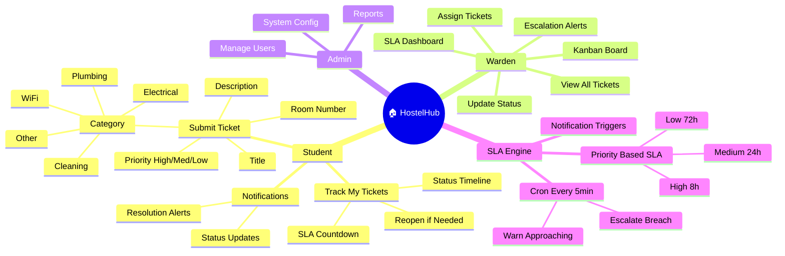
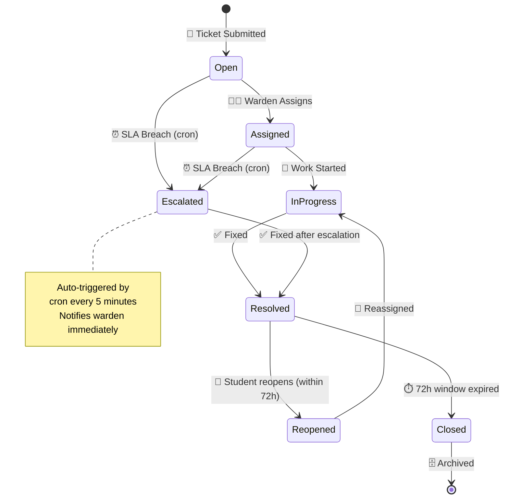
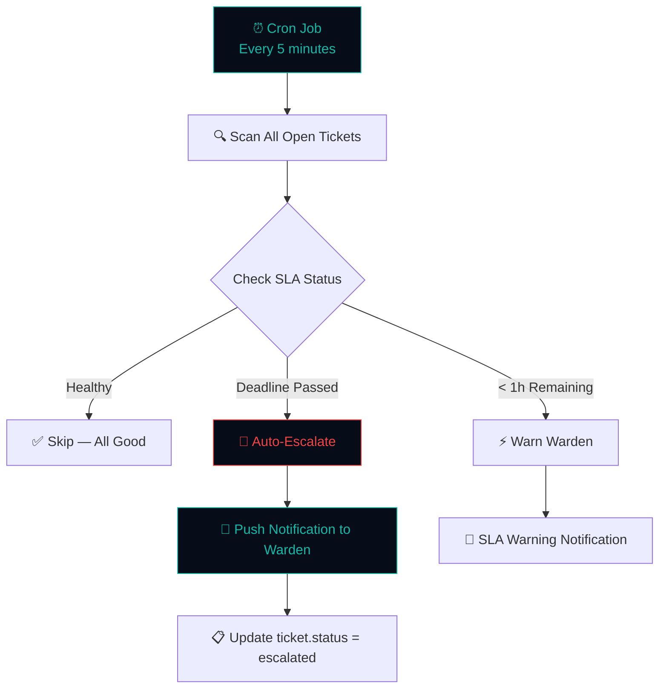
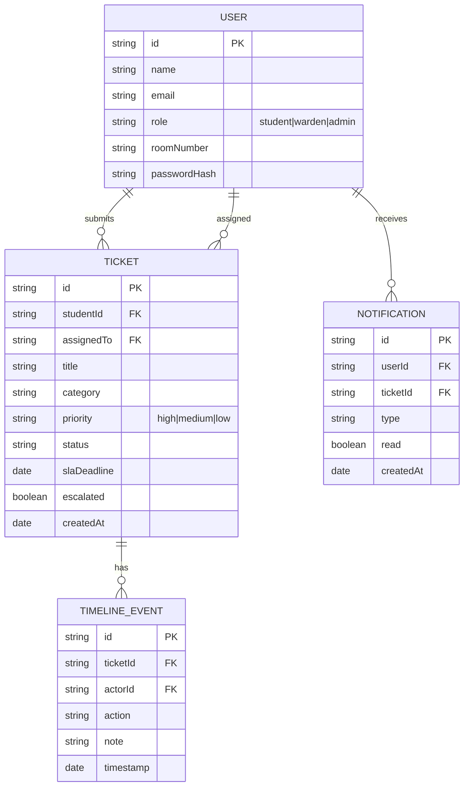

<div align="center">

```
██╗  ██╗ ██████╗ ███████╗████████╗███████╗██╗     ██╗  ██╗██╗   ██╗██████╗
██║  ██║██╔═══██╗██╔════╝╚══██╔══╝██╔════╝██║     ██║  ██║██║   ██║██╔══██╗
███████║██║   ██║███████╗   ██║   █████╗  ██║     ███████║██║   ██║██████╔╝
██╔══██║██║   ██║╚════██║   ██║   ██╔══╝  ██║     ██╔══██║██║   ██║██╔══██╗
██║  ██║╚██████╔╝███████║   ██║   ███████╗███████╗██║  ██║╚██████╔╝██████╔╝
╚═╝  ╚═╝ ╚═════╝ ╚══════╝   ╚═╝   ╚══════╝╚══════╝╚═╝  ╚═╝ ╚═════╝ ╚═════╝
```

### 🏠 *Hostel complaints — every one on the clock. Zero ignored.*

<br/>


<br/>

> **"A hostel complaint without an SLA is just a wish. HostelHub gives every one a deadline."**

</div>

---

## 🏠 What is HostelHub?

**HostelHub** is a full-stack MERN hostel maintenance ticket management system with a built-in **SLA (Service Level Agreement) engine**. Every complaint submitted by a student is automatically assigned a resolution deadline based on priority — and a cron job escalates breaches directly to the warden.

No more "I submitted but nothing happened". HostelHub makes accountability visible to everyone.

---

## ✨ Features

| 🏷️ Feature | 📋 Description |
|---|---|
| 🎫 **Ticket Submission** | Students submit complaints with title, category, priority, room number |
| ⏱️ **SLA Timers** | High = 8h, Medium = 24h, Low = 72h — auto-calculated from assignment |
| ⚡ **Auto-Escalation** | Cron job (every 5 min) escalates approaching/breached SLAs to warden |
| 📋 **Status Timeline** | Created → Assigned → In Progress → Resolved (or Reopened) — full audit trail |
| 🔔 **Notifications** | Real-time alerts for status changes and escalations |
| 👨‍💼 **Warden Kanban** | Board view: Open / Assigned / In Progress / Resolved columns |
| 🔄 **Reopen Window** | 72h reopen window after resolution — students can push back |
| 📊 **SLA Dashboard** | Live SLA health: healthy / warning / escalated counts |

---

## 🗺️ HostelHub Mindmap



---

## ⏱️ SLA Lifecycle



---

## ⚙️ SLA Engine Flow



---

## 🏗️ System Architecture

```mermaid
graph TB
    subgraph FE["🖥️ Frontend (port 5305)"]
        LS[Landing]
        TS[Tickets List]
        TD[Ticket Detail + Timeline]
        KB[Warden Kanban]
        NB[Notification Bell]
    end
    subgraph BE["⚙️ Backend (port 5105)"]
        API[Express /api]
        TR[/tickets]
        NR[/notifications]
        CRON[⏰ SLA Cron Engine]
        UR[/users]
    end
    subgraph DB["🍃 MongoDB"]
        TK[(Tickets)]
        NT[(Notifications)]
        TL[(Timeline Events)]
        US[(Users)]
    end

    FE -->|Axios + JWT| BE
    CRON -->|Every 5min| TK
    CRON --> NT
    TR --> TK
    TR --> TL
    NR --> NT

    style FE fill:#070d18,color:#14b8a6,stroke:#14b8a6
    style CRON fill:#050c15,color:#ef4444,stroke:#ef4444
    style BE fill:#050c15,color:#14b8a6,stroke:#14b8a6
    style DB fill:#030810,color:#14b8a6,stroke:#14b8a6
```

---

## 📊 Data Model



---

## 🎨 Design Identity

```
┌─────────────────────────────────────────────────────────────┐
│                    HOSTELHUB PALETTE                        │
├──────────────┬──────────────┬──────────────┬───────────────┤
│  Console Dark│  Teal Bright │  Danger Red  │  Warn Amber   │
│  #070d18     │  #14b8a6     │  #ef4444     │  #f59e0b      │
│  ████████    │  ████████    │  ████████    │  ████████     │
├──────────────┴──────────────┴──────────────┴───────────────┤
│  Typography: Manrope (Display) + IBM Plex Mono (Code/Data)  │
│  Aesthetic: Terminal console · SLA spine colors · dark ops  │
└─────────────────────────────────────────────────────────────┘
```

---

## 🚀 Quick Start

```bash
cd hostelhub/backend && cp .env.example .env && npm install && npm run dev
cd hostelhub/frontend && npm install && npm run dev
open http://localhost:5305
```

### 🎭 Demo Accounts
| Role | Email | Password | Access |
|------|-------|----------|--------|
| 🎓 Student | `dev@demo.com` | `Demo@1234` | Submit & track tickets |
| 🔑 Warden | `warden@demo.com` | `Demo@1234` | Full kanban + assign |
| ⚙️ Admin | `admin@demo.com` | `Demo@1234` | System settings |

---

<div align="center">

### 🏠 Every complaint has a deadline. Every deadline has a consequence.


</div>
